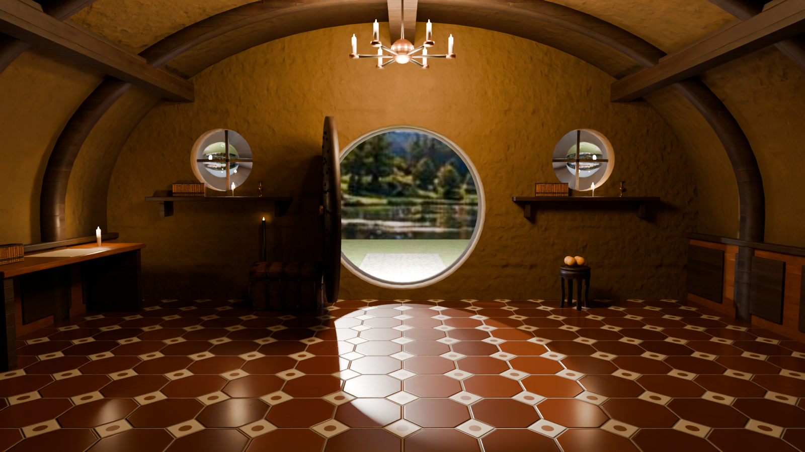
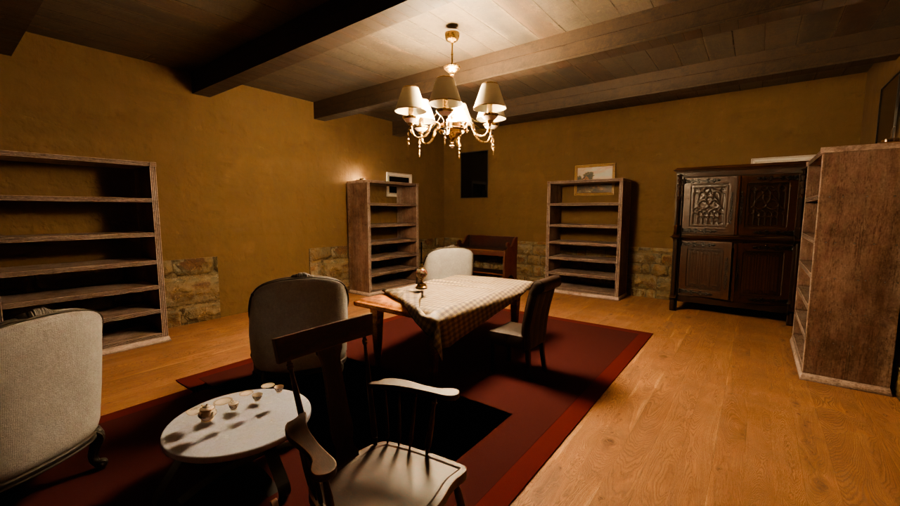
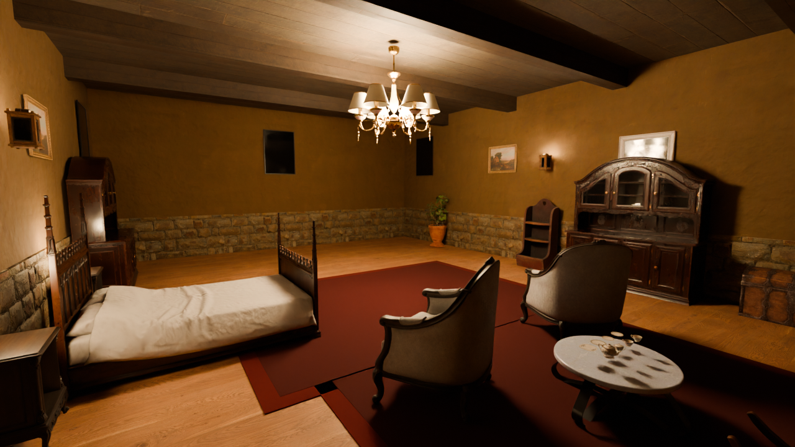
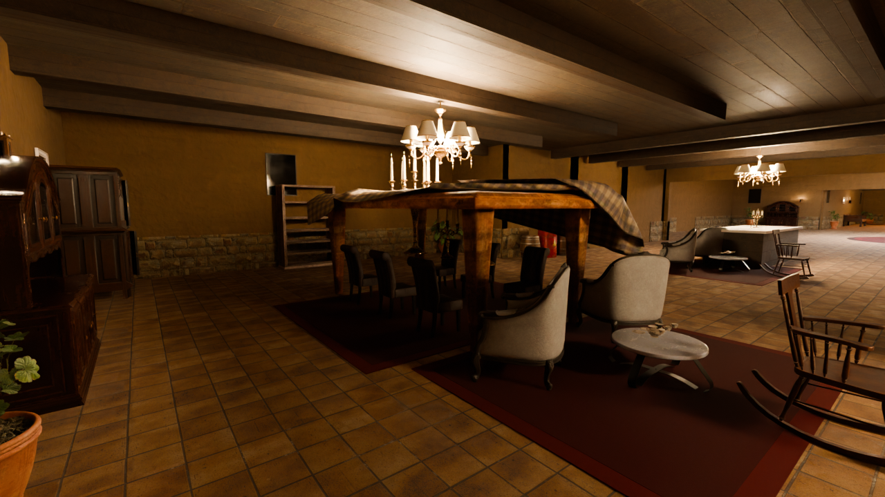
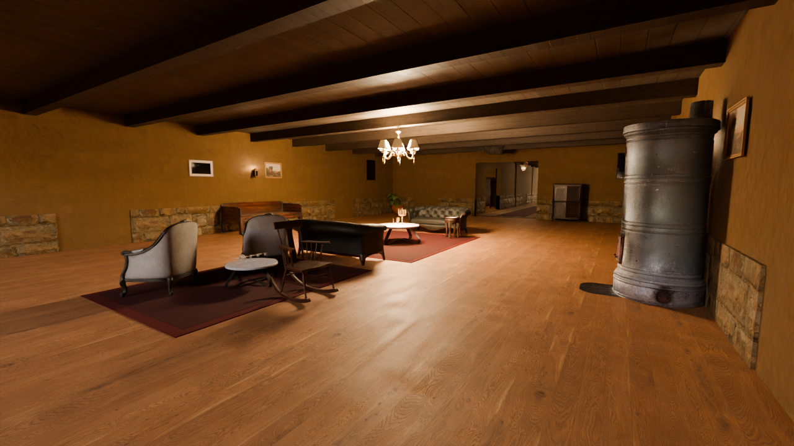
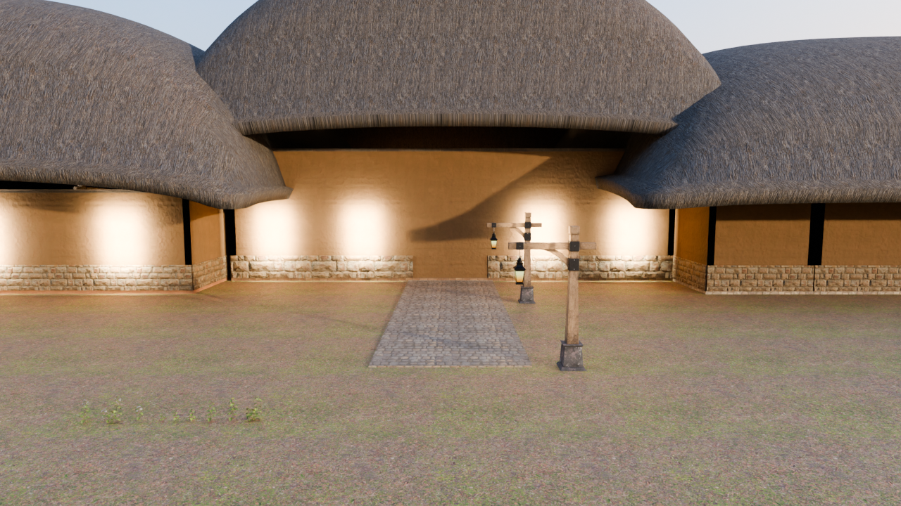
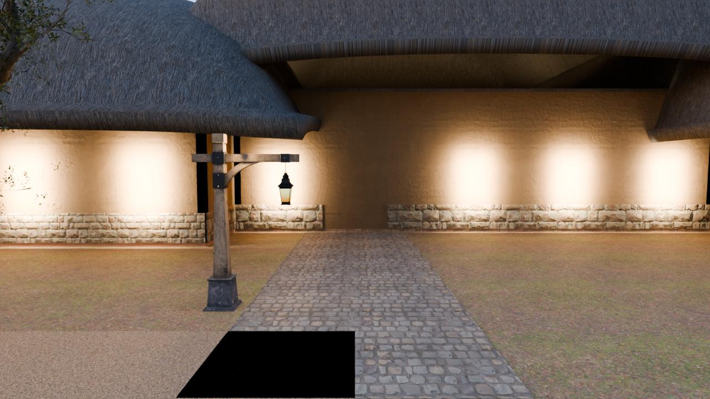

# Hillside Hobbit House

A walkable 3D model of the hobbit house and its estate, built with [three.js](https://threejs.org) and free photo-scanned 3D models. It runs in any modern browser, with no install.

## Play it

**Full instructions, including the photoreal Blender version: [PLAY.md](PLAY.md).**

Once GitHub Pages is switched on (see below), the game is at:

**https://leonieschneiderdk-a11y.github.io/hobbithouse/**

| Key | Action |
| --- | --- |
| W A S D / arrow keys | Walk |
| Mouse (click the view first) | Look around |
| Shift | Run |
| Space | Jump |
| M | Map: click anywhere to go there |
| Graphics button | Exposure, bloom, sun height and direction, lamp brightness, haze, shadows |

The lift in the entrance hall goes down to the garage: walk in and stand still.

## Turn on hosting (one time)

1. In this repository, open **Settings → Pages**.
2. Under **Build and deployment → Source**, choose **GitHub Actions**.
3. Push to `main` (or run the **Deploy to GitHub Pages** workflow from the Actions tab). The site goes live a minute or two later.

## Run it locally

The page loads models with `fetch`, so open it through a local web server rather than by double-clicking the file:

```bash
python3 -m http.server 8000
```

Then open http://localhost:8000.

## Rooms, one at a time

Rooms are being rebuilt one by one as real 3D rooms from their images. See [ROOMS.md](ROOMS.md) for the list, renders and walkable links.

## Round-door hall (fully 3D room)

`hall.html` is a complete 3D room you can walk all the way around with WASD, rebuilt from the round-door reference image: timber-ribbed vault, the round door standing open onto the lake, round windows over shelves, octagon tile floor, candle chandelier, desk, chest and an arch into the passage. It is built by `blender/hero_room.py`, which also renders the photoreal still below.



## Your room images in 3D

Every room with a picture on the Canva board shows that picture as a 3D scene, standing at the room's entrance wall and facing in. Walk in with WASD: from the doorway it matches the image, and as you move the furniture, lamps and beams shift in depth against the walls behind them.

`tools/photo3d.py` makes these from the images. Depth Anything V2 (large) estimates the depth of each picture, the depth edges are snapped to the edges in the photo, the picture is split into foreground and background wherever the depth jumps, and the strip of wall hidden behind each object is filled in by inpainting so moving sideways reveals wall instead of stretched streaks. The results are in `assets/photo3d/`.

## How it is built

| Path | What it holds |
| --- | --- |
| `index.html` | The whole game: floor plan, rooms, grounds, lighting, post-processing and controls |
| `assets/models/` | Poly Haven models (furniture, chandeliers, barrels, trees, rocks), compressed to `.glb` |
| `assets/khronos/` | Models from the Khronos glTF sample library (velvet sofa, plant, lantern, coals, car) |
| `assets/photo3d/` | Each room image with its depth and filled-in background, used to build the 3D photo rooms |
| `assets/hdri/` | Poly Haven sunset sky, used for realistic reflections |
| `assets/materials/` | Photo-scanned Poly Haven surface materials (colour, relief and roughness maps) for walls, stone, wood, floors, ceilings, the thatched roofs and the ground |

The floor plan is defined in pixels from the drawn plan (`room({... px:[x0,y0,x1,y1] ...})`), at 0.12 m per pixel. Every door and opening gets a keep-clear zone, and furniture that would block one is removed when the world is built.

Each piece of furniture is placed as a stand-in box first, then swapped for the matching scanned model once it loads. To use a different model, drop a `.glb` into `assets/models/` and add it to the `MODELS` list in `index.html`.

## Credits

See [CREDITS.md](CREDITS.md).

## Automated Blender build (photoreal)

`blender/build_scene.py` builds the house in Blender with no manual work. It reads the room layout from `index.html`, so the Blender house always matches the web game. It builds walls with arched openings, floors, ceilings, beams and a stone dado, all with the Poly Haven materials. It then places the Poly Haven models, lights the scene with the sunset sky, the sun, a skylight, windows and lanterns, and renders it with Cycles.

```bash
pip install bpy==4.2.0        # needs Python 3.11; this is Blender as a Python module
python blender/build_scene.py --rooms entrance,living2 --render out.png --samples 64 --res 1920x1080
python blender/build_scene.py --rooms all --blend house.blend   # whole house, saved as a .blend you can open in Blender
```

| | |
| --- | --- |
|  |  |
|  |  |
|  |  |
