# Rooms, built one at a time

Each room is rebuilt as a real 3D room from its image, then saved so they can be joined into the full house at the end.

| Room | Build script | 3D model | Walk it | Render |
| --- | --- | --- | --- | --- |
| Round-door hall | `blender/hero_room.py` | `assets/hero/hall.glb` | [hall.html](hall.html) | 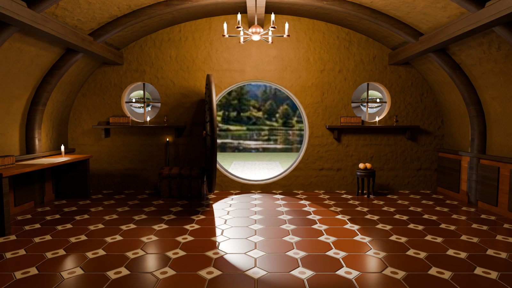 |
| Main entrance | `blender/rooms/entrance.py` | `assets/rooms/entrance/entrance.glb` | [room.html?r=entrance](room.html?r=entrance) | 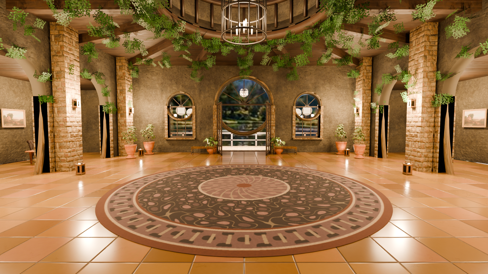 |
| Kitchen | `blender/rooms/kitchen.py` (textures: `tools/kitchen_textures.py`) | `assets/rooms/kitchen/kitchen.glb` | [room.html?r=kitchen](room.html?r=kitchen) | 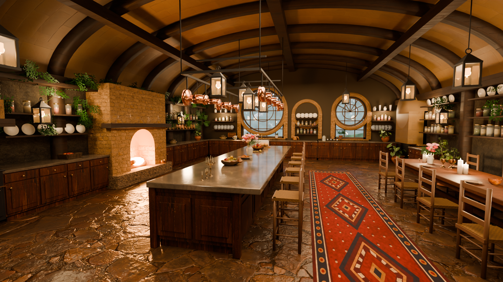 |
| Dining room | `blender/rooms/dining.py` (rug: `tools/dining_textures.py`) | `assets/rooms/dining/dining.glb` | [room.html?r=dining](room.html?r=dining) | 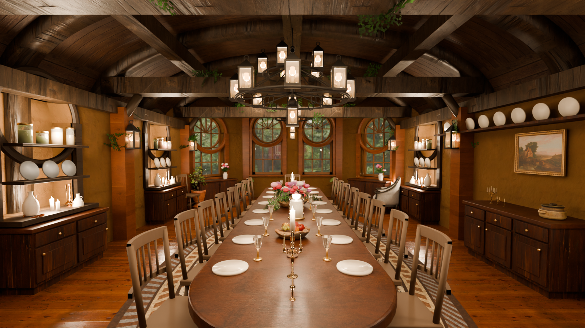 |
| Wine & food cellar | `blender/rooms/cellar.py` (rug: `tools/cellar_textures.py`) | `assets/rooms/cellar/cellar.glb` | [room.html?r=cellar](room.html?r=cellar) | 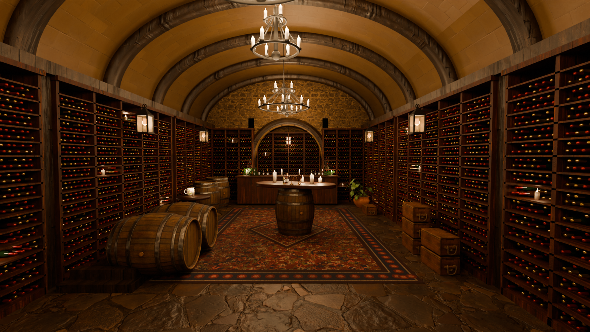 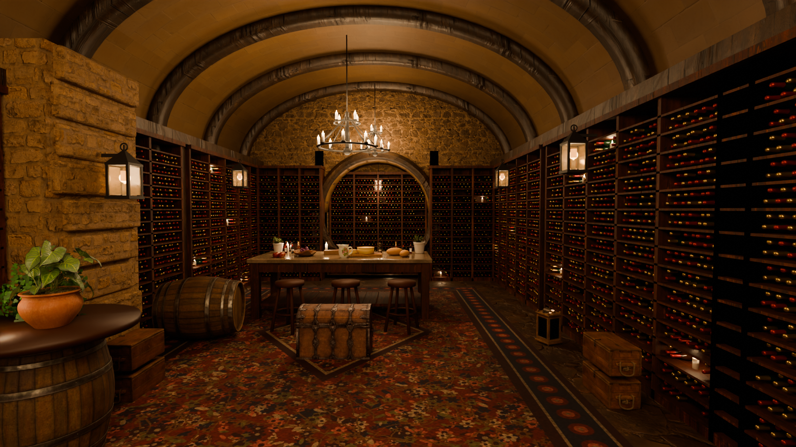 |
| Pantry | `blender/rooms/pantry.py` | `assets/rooms/pantry/pantry.glb` | [room.html?r=pantry](room.html?r=pantry) | 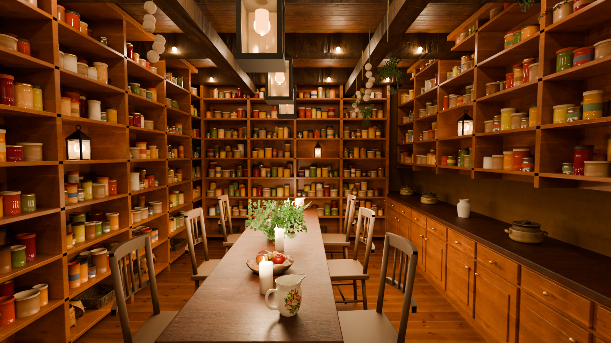 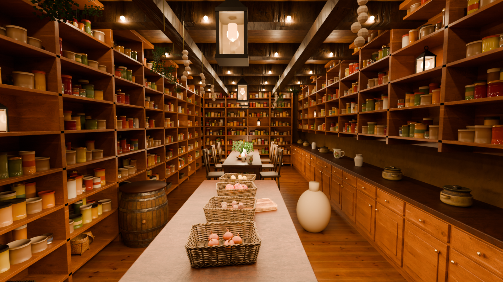 |
| Hallway | `blender/rooms/hallway.py` (runners: `tools/hallway_textures.py`) | `assets/rooms/hallway/hallway.glb` | [room.html?r=hallway](room.html?r=hallway) | 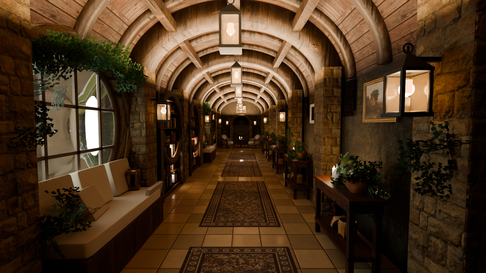 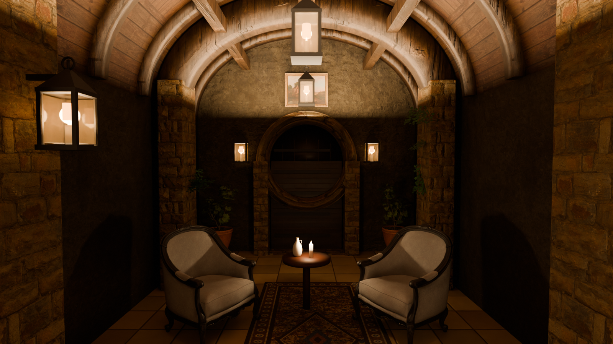 |
| Bathroom & spa | `blender/rooms/bathroom.py` | `assets/rooms/bathroom/bathroom.glb` | [room.html?r=bathroom](room.html?r=bathroom) | 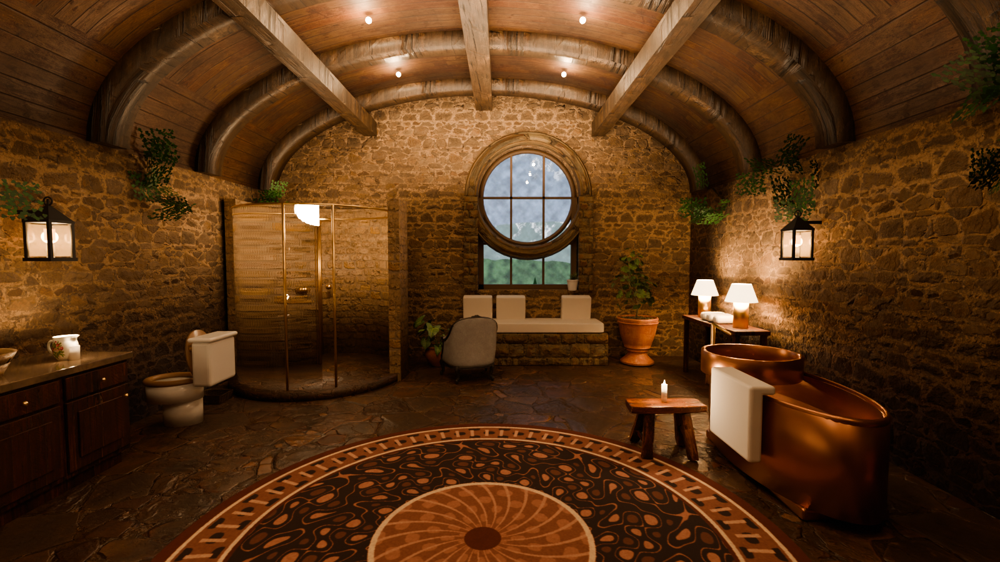 |

## Adding the next room

1. Copy `blender/rooms/entrance.py` to `blender/rooms/<room>.py` and change `build()` to match the room's image.
2. Render and export: `python blender/rooms/<room>.py --render docs/rooms/<room>.png --samples 128 --res 1600x900 --glb assets/rooms/<room>/<room>.glb`
3. New props come from Poly Haven with `python tools/fetch_polyhaven.py <work_dir> <asset ids...>` (run with the Blender Python).
4. Add `assets/rooms/<room>/room.json` (model path, spawn point, walkable areas; the kitchen script writes its own, including the colour tints Blender uses so the browser matches the render) and open `room.html?r=<room>`.

When every room is done, the saved models are placed at their positions on the floor plan and connected through their doorways.
